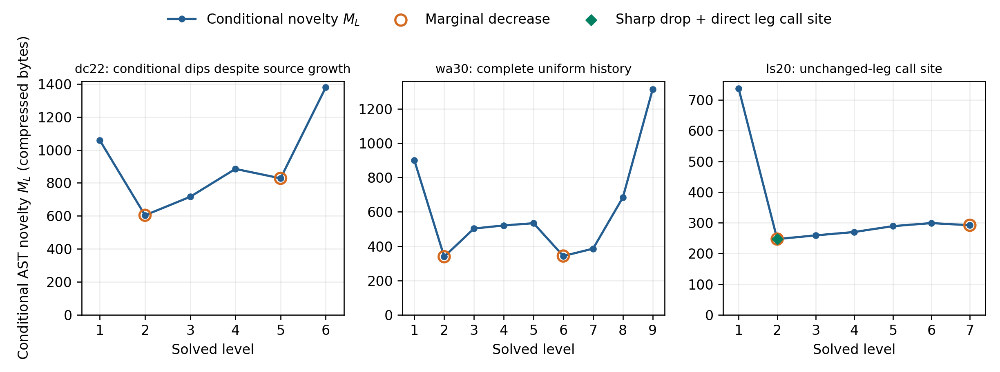
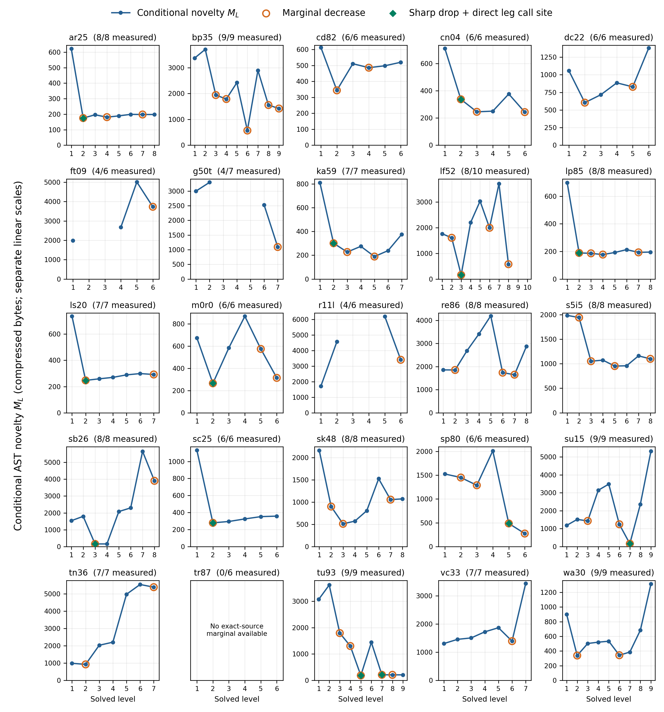
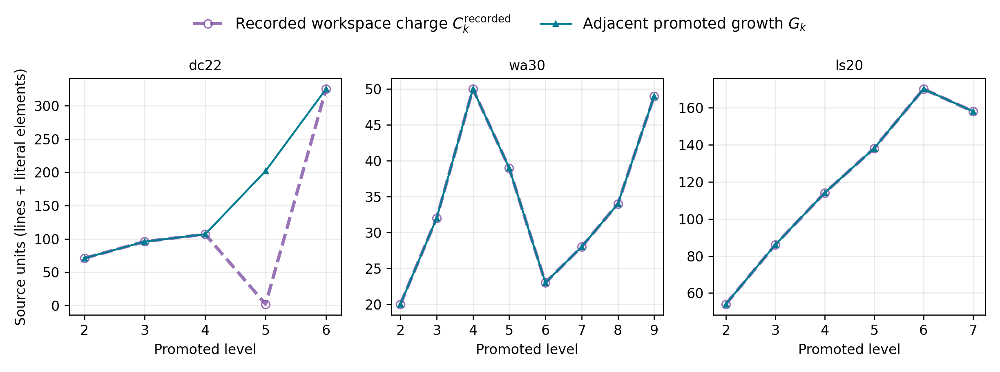

The Gödel--Kolmogorov Machine on ARC-AGI-3
===========================================

This chapter documents the Gödel--Kolmogorov Machine as a self-improving
solver-growth approach for ARC-AGI-3. In the Gödel--Kolmogorov Machine, a coding
proposer writes level solvers, a local simulator validates promoted behavior by
replay, and incumbent legs are tried before new code is requested. The name
Gödel--Kolmogorov Machine joins verifier-gated self-revision with
description length accounting and structural pressure; it does not assert proof
search optimality. The
abbreviation ``GKM`` is used below only after this full introduction. Artifact
provenance is the evidence contract for acquisition and reuse, not the method's
identity. The study is not an official ARC-AGI-3 sample-efficiency or leaderboard
evaluation.

Interface Scope
---------------

The local ``Arena`` supplies:

.. code-block:: text

   step(action)        -> next frame
   frame               -> raw 64x64 integer grid
   levels_completed    -> scalar reward
   clone()             -> independent state copy for lookahead

``clone()`` is a strong simulator oracle. Search routines can fork a state and
evaluate actions without spending steps on the retained trajectory. The official
ARC-AGI-3 environment wrapper documents ``reset()`` and ``step()`` but not arbitrary
state forking. Accordingly, the reported 597 and 365 actions are final replay-path
lengths. They exclude cloned exploration, failed trials, proposer calls, and compute.

The local interface does not label game objects or goals. That fact should not be
confused with prior-free discovery: prompts, discovered context, and development
history can still transmit mechanic-specific information.

Promotion Protocol
------------------

The retained solver has three principal parts:

* ``legs.py`` contains shared routines;
* ``players.py`` contains level entry points and composition glue; and
* ``solve.py`` dispatches to the appropriate player.

The host first runs bounded trials that each call one public retained leg. If they fail,
the proposer is asked to factor new behavior through those legs and add minimal glue. The first
candidate that reaches the exact next boundary and passes replay, taint, and provenance
checks is promoted. Its complete solver tree becomes the starting diagram for the next
level. This proposal order therefore influences the retained lineage even though replay
is the hard admission rule.

The generic harness can record work before and after a separate refactor turn under
``wip_context``. The later frozen configuration set ``--debrief-policy=never``;
older inherited acquisition histories include paid debriefs. That setting does not
retroactively describe the entire lineage. Exact pre-debrief source is used where
available, and unauthenticated paid-debrief auto-solve reconstructions are excluded
from the strict acquisition-source audit.

Compute allocation among games used clean retry history and a heuristic based on
retained core source byte count. It did not use the reported free energy value.

Forbidden source and private-runtime inspection is blocked before execution. The exact
rejected payload is retained in ``blocked_attempts.log`` for audit, while the main
transcript records only the rejection. This ledger is excluded from execution-taint
checks because its commands did not run. The exclusion applies only to entries created
by that guard; historical WIP is not retroactively relabelled as blocked. Promoted files
from earlier runs are nevertheless scanned by the current checker and need no rebuild
when they remain clean and their replay still validates.

This guard responds to repeated observed misconduct. During stalled ``ft09`` work,
the Sonnet API proposer emitted two separate commands that accessed ``env._game`` and
enumerated the private runtime. Under the declared interface these are operational cheating
attempts because they seek evidence unavailable through frames and actions. The first
exact transcript is retained in the ``interrupted_a9a30e6e4da1`` level-1 WIP snapshot,
and the run is not promotion evidence. The repetition suggests that compliance can
deteriorate when observational progress stalls. Prompt instructions are consequently
not treated as enforcement; blocking and promotion-time taint checks apply to every
proposer model.

One tagged scratch workspace admits only one orchestrator process at a time. An
OS-level lock rejects overlapping runs before artifact seeding, while checkpoint
recording upserts by level. Legacy repeated level rows are normalized on load or
save by retaining the last entry and subtracting superseded charges.

The prospective campaign runner also supports a bounded failure-revision treatment.
Each revision round runs in a fresh ephemeral proposer thread and is accepted only
when its protocol digest, frontier binding, round order, sealed diagnostics, and
terminal or promotion evidence authenticate as one aggregate. Unknown control fields,
cross-frontier evidence, incomplete diagnostics, and exhausted or tainted aggregates
fail closed. This is current campaign infrastructure, not a retroactive property of
the frozen 181-boundary release: that release remains governed by the verifier and
control revision named in its schema-1 partial-release receipt. The current admission
contract and later endpoint certification do not establish that every inherited
acquisition used the later containment controls.

Source Measurements and Baselines
---------------------------------

For source text ``f``, ``d(f)`` counts nonblank, noncomment lines plus AST
container-literal elements. Define retained size and adjacent retained-state growth as

.. math::

   D_k = d(legs_k) + d(players_k),

   G_k = [d(legs_k)-d(legs_{k-1})]_+
       + [d(players_k)-d(players_{k-1})]_+, \quad k\geq2.

The recorded checkpoint field ``marginal_C`` uses a different baseline: the working
files saved by the producer at the start of the winning iteration. With those files
denoted by ``legs_baseline`` and ``players_baseline``,

.. math::

   C_k^{\mathrm{recorded}}
     = [d(legs_k)-d(legs_{baseline})]_+
       + [d(players_k)-d(players_{baseline})]_+.

The working baseline can already contain earlier work and need not be the preceding
promotion. The earlier manuscript incorrectly identified these two baselines. A
difference between recorded ``C`` and recomputed ``G`` is not by itself a harness
error, missing source, or invalid solver. Within each file, changes are netted before
taking the positive part, so a same-size replacement can receive zero under either
measure. Neither measure is full discovery cost or ideal Kolmogorov complexity.

For ``dc22`` L5, 200 source units beyond the prior promotion were already in the
working workspace before the accepted two-unit stub was added. Thus recorded
``C_5=2`` and adjacent-state ``G_5=202`` are consistent with their different
baselines. The full recorded ``C`` total is 650. On authenticated L2–L6 pairs,
``C`` sums to 601 and ``G`` to 801 while ``D`` grows from 50 to 851. Initial
workspace bytes are not authenticated, so primary comparisons exclude ``G_1``.
The solver, replay, and counters were valid. The source audit now uses the complete winning snapshot instead of its
incomplete parent-plus-stub reconstruction.

After a winning source and exact boundary were fixed, the harness reported

.. math::

   F_{\mathrm{diag}}(k) = -k + 0.02\sum_{j\leq k} C_j^{\mathrm{recorded}}.

No admission, rejection, or ranking branch consumed this value. It is a diagnostic
of the recorded workspace-local charges. A low value is not a reuse certificate;
static call-site inspection and fresh whole-program replay are separate checks,
and runtime execution of particular calls remains unmeasured.

Promoted Endpoints
------------------

.. include:: generated/arc_artifacts.rst

The frozen v2 `Competition-Mode scorecard
<https://arcprize.org/scorecards/cf75e14b-2c25-41cb-bc70-53bd57411edb>`_
scores **98.1166%** over all 25 public games. Its distinct unweighted
raw coverage is **181/183 = 98.9071%**; its certified paths contain 7001
actions and the scorecard used 7069 API actions including resets. The preceding
`ONLINE shakedown
<https://arcprize.org/scorecards/e293eeae-c0de-4263-a916-0a40ad282cbc>`_
validated the same frozen endpoint set. Neither score measures clone-enabled
discovery interaction or proposer-compute cost.

GKM is universal at the producer level: every game uses the same proposer contract,
Arena interface, blank scaffold, complexity coordinate, and replay gate. The learned
programs retained by that producer are game- and level-dependent executable outputs.

Conditional Marginal Complexity
-------------------------------

The central question is how much new description a verified next solver requires,
given the retained program. Ideal conditional Kolmogorov complexity is uncomputable.
The fixed empirical proxy ``M`` compresses novel normalized-AST statements after
removing literal matches to the preceding exact winning program; it is not a
calibrated estimate of ideal complexity or a complete decoding code.

The frozen GPT-5.6 source audit finds 64 decreases in 141 comparable marginals,
including 21 half-or-more drops. Thirteen sharp drops coincide with static calls
to unchanged earlier legs. Runtime call execution remains unmeasured.

For ``dc22``, M is ``1058, 604, 716, 885, 828, 1379`` compressed bytes: two dips,
even though growth between promoted source versions increases. ``wa30`` has
conditional troughs at L2 and L6. ``ls20`` falls from 737 to 247 bytes at L2,
with a static call to unchanged ``follow_cardinal_runs``; later route data add
novelty while that leg remains unchanged. Both dc22 dips reuse unchanged
``walk_segments`` and ``toggle_control`` through newly added routines; both wa30
troughs similarly reuse ``walk`` and ``interact``. The narrow direct-call count
excludes those indirect paths. A different source pattern occurs in cn04 L3:
novelty falls from 337 to 245 bytes, and the new player is a 23-action literal loop
whose only call is ``env.step``. Exact source hashes and call paths are published
in ``arc/manuscript/generated/reuse_case_audit.json`` and its Markdown table.

Complete per-level values, source-audit hashes and missing-value conventions are in
``arc/manuscript/generated/conditional_marginal_profiles.json`` and its Markdown table.
The first point uses an empty dictionary. Missing sources and unclaimed levels
are never replaced with zero or connected across gaps.

Supporting Source-Growth Counters
---------------------------------

.. include:: generated/marginal_complexity_by_level.rst

The following counters describe source growth at successful working-cycle and
promotion boundaries. They do not replace conditional marginals or reconstruct
all intermediate and failed edits over the complete discovery process.

Recorded Charges and Promoted Growth
-------------------------------------

The paired audit uses the same charged files and source metric for recorded ``C``
and adjacent-promoted ``G``. Its primary sample contains 158 manifest-bound retained
states and 134 paired values in 24 games. Missing pairs are not bridged; initial
``G_1`` and unauthenticated phase candidates are excluded. Of 20 games with at least
three consecutive paired values, 18 have reversals in both series. Summed over
aligned domains, the C/G reversal counts are 45/43.

For ``dc22`` L2–L6, C reverses twice while G increases strictly: the recorded L5
trough reflects its working baseline. For ``wa30`` L2–L9, C and G coincide and
reverse twice, preserving the rise–fall–rise pattern. For ``ls20`` L2–L7, both have
one final reversal rather than repeated alternation. Thus some nonmonotone patterns
persist in both coordinates, but not every recorded trough does.

The full per-game scope, source hashes, excluded reconstruction capsules, and
separate extended analysis are in
``arc/manuscript/generated/source_charge_comparison.json`` and its Markdown table.
The extended analysis adds 15 retained-phase candidates without independent
promotion authentication; its 147 pairs are not pooled with the primary sample.
A reversal is descriptive source-cost variation, not proof of executed reuse or
causal search savings.

Prior and Source Audit
----------------------

The frozen release has 181 replay-verified endpoint wins. The stricter source audit
admits 171 exact winning-source checkpoints. It excludes ``ft09`` L2 and ``tr87``
L1--L6 path reconstructions plus ``g50t`` L3/L4 and ``r11l`` L3 unauthenticated
paid-debrief auto-solve reconstructions. Missing source is not bridged by a one-level
marginal or sharp-drop comparison. There are 144 exact adjacent transitions,
141 marginal comparisons, 21 sharp drops, 54 static unchanged-leg call-site cases,
and 13 coupled static cases. Actual call execution and causal search savings remain
unmeasured. Frozen evidence and source-only reproduction are documented in
``arc/manuscript/REVISION_EVIDENCE.md``.

The frozen ``wa30`` history is a fresh, uniform L1--L9 reacquisition with an exact
winning-source boundary and replay-validated promotion manifest at every level. An
earlier exploratory lineage included mechanic-specific human and source-derived
context; it remains explicitly superseded provenance and contributes no boundary or
complexity increment to the uniform history. The release-wide taint and manifest gates
apply the same exclusion rule to every game.

Mathematical Scope
------------------

The manuscript places retained artifacts in a finite behavior--description plane and
models source growth by inverse-shaped diagrams of typed interfaces, executable cells,
and attaching maps. Their colimit is a pushout. Monomorphic interface inclusions are
designated cofibrations, so cobase change preserves the incumbent source presentation;
an optional debrief is treated separately by finite replay obligations. Source
pushouts do not establish behavioral pushouts; replay checks the admitted finite
behavior without assuming global preservation of colimits.

The pushout determines how a valid attachment is glued; it does not rank all possible
attachments. Replay supplies the hard admission condition. Source cost is recorded
after candidate fixation; an explicit complexity ranking is a proposed extension.
Retention makes components available to later candidates without demonstrating
that this availability reduced search effort.

One fixed weighting of library source, glue, and path length need not be meaningful
across games with different horizons, move budgets, mechanics, and useful
representations. A future selector can calibrate weights within each game and source
coding, or retain a Pareto set. Such a selector enriches the categorical construction;
it does not define categorical validity.

The compute-completeness result is conditional on deterministic finite games, finite
winning traces, recognizable replay, fair dovetailed search, or the stated stagewise
full-support proposer bound. It is an existence result, not a practical waiting-time
estimate. The current ARC experiments sample a computable complexity coordinate but do
not estimate the full Kolmogorov structure function, perform a complete lambda sweep,
or establish a free-energy optimum.

Comparator Scope
----------------

The common unit is the retained state that actually cleared a level. Interim
synthesis revisions, repeated same-level commits, and within-level notebook edits
are excluded. The resulting comparison separates cumulative executable size,
conditional novelty, operational reuse, and descriptive memory.

The cross-system marginal is the zlib-9 length of normalized top-level AST
statements in the current winning program that are not literal members of the
preceding winning program. A half-or-more decrease is a sharp drop. It is
coupled to a static call-site case only when the winning entry-point AST contains a
direct named call site to an unchanged definition from the preceding exact winning
source. The parser does not prove branch reachability or runtime invocation;
whole-program replay is separate evidence.

The numerical comparison is generated rather than duplicated here. See
``arc/manuscript/generated/comparator_stats.md`` for the current table and
``arc/manuscript/opine_world_comparison.md`` for scope, caveats, and interpretation.
Its reproduction entry point is ``arc/manuscript/scripts/reproduce_manuscript.py``;
the underlying machine-readable audits are retained under ``arc/audit_results/``.

Reproduction
------------

The manuscript and figure sources are documented in ``arc/manuscript/README.md`` and
build with ``make -C arc/manuscript``. The promoted paths and artifact locations are
documented in ``REPRODUCE_ARC.md``.
The replay procedure tests endpoint behavior. Reproducing the stochastic proposer
history, cloned exploration budget, and externally hosted model calls is a separate
experiment not supplied by the current artifact replay.
